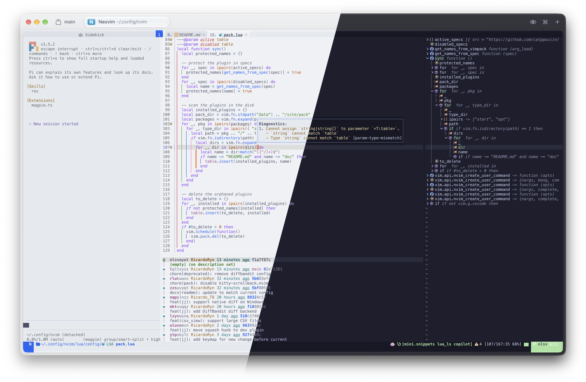

# My Neovim Configuration

> [!IMPORTANT]
> This is NOT a Neovim distribution.
> It's my personal setup shared for reference and inspiration.
>
> Neovim 0.12+. This config relies on features introduced in 0.12:
> the built-in `vim.pack` plugin manager and
> the built-in `vim._core.ui2` notification UI.



## Features

### Plugin Management

All plugins are managed by the built-in `vim.pack`, with the plugin list defined in `lua/config/pack.lua`.

Plugins that are installed but no longer declared in the configuration are considered
orphaned and will be automatically removed the next time Neovim starts.

If you only want to temporarily disable a plugin while keeping it on disk, add it to `disabled_specs`.
These entries will not be loaded but will remain protected from orphan cleanup.

| Command          | Description                             |
| ---------------- | --------------------------------------- |
| `:PackStatus`    | Check plugin status without downloading |
| `:PackUpdate`    | Check and update plugins (with dry-run) |
| `:PackUpdate!`   | Update plugins (skip confirmation)      |
| `:PackDel <...>` | Remove installed plugins                |

### Startup

`vim.loader` is enabled, so compiled Lua modules are cached between
launches. Completion (`mini.completion` plus `mini.snippets`) is set up
lazily on the first regular file buffer (`lua/config/completion.lua`).

`:StartupTime` reports the total from the log written by
`nvim --startuptime`; `plugin/startuptime.lua` also ships a small
wrapper that passes the flag and prints the result of every launch.

### Pre-configured LSP

Six language servers are pre-configured in `lsp/` and enabled via
`vim.lsp.enable()` (`lua/config/lsp.lua`). In standalone Neovim, Mason
automatically installs these servers if they're missing:

- `lua_ls`
- `pyright`
- `bashls`
- `marksman`
- `rust_analyzer`
- `texlab`

### Custom Modules

Some features are too simple to warrant a full plugin. These custom modules
provide lightweight, self-contained logic:

| Module           | Description                                                                 |
| ---------------- | --------------------------------------------------------------------------- |
| `sessions`       | Auto-save/restore sessions per working directory (lives in `plugin/`)       |
| `buffer_actions` | Buffer cycle, move, close, pin — used by heirline tabline                   |
| `csv_view`       | Aligned CSV columns, sticky headers and sampled widths for large files      |
| `heirline`       | Statusline (15+ components) & tabline (bufferline/tabpages) building blocks |
| `lazy`           | Run plugin setup on the first mapped key or command                         |
| `mini_nvim`      | mini.files extensions; archived configs use the picker and indent helpers   |
| `snacks_nvim`    | snacks.nvim setup/extensions — pickers, indent, todos, debug tools          |
| `icons.lua`      | Icon glyph mappings (diff, diagnostics, DAP, etc.)                          |
| `jj_log`         | Fetch `jj log` info for statusline display                                  |
| `special_mode`   | Detect diff/merge-tool launch (e.g. jj, hunk.nvim)                          |
| `system`         | OS detection (Windows/macOS/Linux + distro)                                 |

`lua/utils/deprecated/` contains legacy configurations. None of the files
in this directory are loaded; they serve only as backups and references.

### VSCode Integration

This configuration supports modal editing in VSCode through
[VSCode Neovim](https://github.com/vscode-neovim/vscode-neovim).

> Personally, I need to edit Jupyter Notebooks, but Neovim's support for them is quite limited,
> so I have to use VSCode for that purpose. However, I've become so accustomed to Neovim's
> modal editing that I can't work efficiently without it. So I tried using Neovim within VSCode,
> and it works quite well.

#### Setup

1. **Install the `VSCode Neovim` extension** from the VSCode Marketplace.

2. **Configure the extension** in your VSCode settings (`settings.json`):

   ```json
   {
     // vscode-neovim
     "vscode-neovim.neovimClean": false,
     "extensions.experimental.affinity": {
       "asvetliakov.vscode-neovim": 1
     },
     "vscode-neovim.compositeKeys": {
       "jk": {
         "command": "vscode-neovim.escape"
       }
     }
   }
   ```

3. For a better experience, some keybindings need to be configured in VSCode's
   `keybindings.json`. See my [settings](docs/Code/keybindings.json) for reference.

#### Available Plugins in VSCode

`vim.pack` adds the same plugin specs in both environments. Most plugin
configuration scripts skip setup when `vim.g.vscode` is set, leaving the UI
and terminal to VSCode. The following editing plugins are configured in VSCode:

- **flash.nvim** - Fast cursor jumping
- **mini.ai** - Enhanced text objects for smarter editing
- **mini.bracketed** - Jump to previous/next targets with `[` / `]`
- **mini.jump** - Enhanced `f`/`t` jumping with target highlighting
- **mini.misc** - Helper utilities (`safely` deferred/lazy setup)
- **mini.move** - Move selections and lines in any direction
- **mini.operators** - Sort, replace, multiply, evaluate text
- **mini.pairs** - Auto-close brackets and quotes
- **mini.splitjoin** - Code splitting and joining
- **mini.statuscolumn** - Custom statuscolumn (signs, folds, line numbers)
- **mini.surround** - Quick surround operations (add/delete/change)
- **nvim-treesitter-textobjects** - Treesitter-based text objects

For the main VSCode-specific bindings, see [VSCode Keymaps](#vscode-keymaps) below.

## Project Structure

```text
~/.config/nvim/
├── init.lua                  # Entry point
├── nvim-pack-lock.json       # Plugin version lock
├── stylua.toml               # Lua formatter config
├── .luarc.json               # Lua LSP config
├── .github/                  # CI workflows
│
├── lua/
│   ├── config/               # Core configuration
│   │   ├── autocmds.lua      # Auto commands
│   │   ├── completion.lua    # Deferred mini.completion + mini.snippets setup
│   │   ├── keymaps.lua       # Key mappings
│   │   ├── lsp.lua           # LSP servers enable + LspAttach keymaps
│   │   ├── options.lua       # Neovim options
│   │   └── pack.lua          # vim.pack plugin specs
│   │
│   ├── dev/                  # Local plugins + loading from a development checkout
│   ├── neogen/               # Neogen annotation templates
│   │   └── python/           # Python docstring templates
│   └── utils/                # Utility modules
│       ├── buffer_actions/   # Buffer management
│       ├── csv_view/         # CSV viewer (aligned columns, sticky header, large files)
│       ├── deprecated/       # Archived configurations (not loaded)
│       ├── heirline/         # Heirline statusline/tabline components
│       ├── lazy/             # Defer plugin setup until a key or command is used
│       ├── mini_nvim/        # mini.files extensions and helpers for archived configs
│       ├── snacks_nvim/      # Snacks.nvim configuration
│       ├── icons.lua         # Icon mappings
│       ├── jj_log.lua        # JJ log helpers
│       ├── special_mode.lua  # Special mode detection (e.g. jj desc, jj split by hunk.nvim)
│       └── system.lua        # System detection (Windows/Mac/Linux)
│
├── plugin/                   # Per-plugin configs + custom scripts
│   ├── sessions.lua          # Session manager (custom)
│   └── ... (one file per plugin)
│
├── docs/                     # Screenshot assets + VSCode keybindings reference
├── ftplugin/                 # Filetype-specific settings (simple)
├── after/                    # Filetype settings & treesitter query overrides
├── lsp/                      # LSP server definitions (nvim-lspconfig defaults)
└── snippets/                 # Custom snippets
```

## Keymaps

Leader key is `<Space>`, and local leader key is `\`.

### Leader Keymaps

<details>
<summary> Click this </summary>

```text
<leader>
├── <Space> -- Find files
├── a (AI)
│   ├── a - Sidekick toggle
│   ├── d - Sidekick detach
│   ├── f - Sidekick send file
│   ├── p - Sidekick prompt
│   ├── s - Sidekick select
│   ├── t - Sidekick send this
│   └── v - Sidekick send visual selection
├── b (Buffer)
│   ├── a - Buffer delete all
│   ├── b - Buffer delete pick
│   ├── d - Buffer delete
│   ├── l - Buffer delete left
│   ├── o - Buffer delete other
│   ├── p - Buffer pin toggle
│   ├── r - Buffer delete right
│   ├── < - Buffer move left
│   └── > - Buffer move right
├── d (Debug / DAP)
│   ├── b - Debug breakpoint
│   ├── B - Debug conditional breakpoint
│   ├── c - Debug run to cursor
│   ├── C - Debug clear breakpoints
│   ├── h - Debug hover
│   ├── i - Debug step into
│   ├── k - Debug step out (same as <leader>dO)
│   ├── l - Debug launch OSV server
│   ├── o - Debug step over
│   ├── O - Debug step out
│   ├── r - Debug restart
│   ├── R - Debug toggle REPL
│   ├── s - Debug start/continue
│   ├── t - Debug terminate session
│   ├── u - Debug toggle UI
│   ├── v - Debug toggle virtual text
│   └── f (Float)
│       ├── e - Debug float expression
│       ├── f - Debug float frames
│       ├── s - Debug float sessions
│       ├── S - Debug float scopes
│       └── t - Debug float threads
├── D (Dev)
│   ├── m - Snacks metrics
│   ├── r - Snacks run lua
│   └── s - Snacks size
├── e (Explorer)
│   ├── e - Files (mini.files)
│   └── f - Files in current folder
├── f (Find)
│   ├── c - Find config file
│   ├── g - Find git files
│   ├── m - Find smart (recent + fuzzy)
│   ├── p - Find projects
│   ├── r - Find recent files
│   ├── t - Find all todos (current file)
│   └── T - Find core todos (current file)
├── g (Git)
│   ├── b - Blame line
│   ├── p - Preview hunk
│   ├── P - Preview hunk (float)
│   ├── r - Reset hunk
│   ├── R - Reset buffer
│   ├── s - Squash hunk (local dev plugin, Windows only)
│   ├── t - Toggle blame line
│   ├── w - Toggle word diff
│   └── h (GitHub)
│       ├── i - GitHub Issues (open)
│       ├── I - GitHub Issues (all)
│       ├── p - GitHub Pull Requests (open)
│       └── P - GitHub Pull Requests (all)
├── j (Jujutsu)
│   ├── a - JJ annotate
│   ├── A - JJ abandon
│   ├── b (Bookmark)
│   │   ├── c - JJ bookmark create
│   │   ├── d - JJ bookmark delete
│   │   └── m - JJ bookmark move
│   ├── B - JJ browse
│   ├── d - JJ diff current buffer
│   ├── D - JJ describe
│   ├── e - JJ edit
│   ├── f - JJ fetch
│   ├── l - JJ log all
│   ├── L - JJ log
│   ├── n - JJ new
│   ├── N - JJ new (insert before current)
│   ├── r - JJ rebase
│   ├── R - JJ redo
│   ├── s - JJ status
│   ├── S - JJ squash
│   ├── U - JJ undo
│   ├── p (Push / PR)
│   │   ├── l - JJ open PR listing available bookmarks
│   │   ├── p - JJ push
│   │   └── r - JJ open PR from bookmark in current revision or parent
│   └── t (Tag)
│       ├── d - JJ tag delete
│       ├── p - JJ tag push
│       └── s - JJ tag set
├── l (LSP)
│   ├── a - LSP code action
│   ├── d - LSP diagnostics (float)
│   ├── f - Format buffer or selection (conform.nvim)
│   ├── i - LSP implementation
│   ├── m - Toggle split/join (mini.splitjoin)
│   ├── n - LSP rename
│   ├── N - Generate docstring
│   ├── r - LSP references
│   ├── R - LSP restart
│   ├── t - LSP type definition
│   ├── v - Virtual Env (Python only)
│   └── x - LSP codelens
├── n (Notification)
│   ├── m - Messages
│   └── n - Notification history
├── o - Outline
├── P (Pack)
│   ├── s - Pack status
│   ├── u - Pack update
│   └── U - Pack update (no confirmation)
├── s (Search)
│   ├── b - Search buffers
│   ├── c - Search commands
│   ├── d - Search diagnostics (buffer)
│   ├── D - Search diagnostics
│   ├── h - Search help pages
│   ├── H - Search highlights
│   ├── i - Search icons
│   ├── I - Search incoming calls
│   ├── j - Search jj changed files
│   ├── J - Search jumps
│   ├── k - Search keymaps
│   ├── l - Search LSP info
│   ├── L - Search locations (loclist)
│   ├── m - Search marks
│   ├── M - Search man pages
│   ├── O - Search outgoing calls
│   ├── p - Search spelling
│   ├── P - Search pickers
│   ├── r - Search resume
│   ├── s - Search LSP symbols
│   ├── S - Search LSP Symbols in workspace
│   ├── t - Search all todos
│   ├── T - Search core todos
│   ├── u - Search undotree
│   ├── v - Search clipboard history
│   ├── x - Search qflist
│   ├── " - Search registers
│   ├── . - Search scratch
│   ├── / - Search history
│   └── : - Search command history
├── t (Tab/Terminal)
│   ├── d - Tab delete
│   ├── f - Terminal float
│   ├── n - Tab new
│   ├── r - Tab rename
│   ├── s - Tab split
│   ├── t - Terminal bottom
│   ├── v - Terminal split
│   └── z - Tab zoxide (tcd)
├── u (UI)
│   ├── a - Toggle animate
│   ├── b - Toggle background
│   ├── c - Select colorschemes
│   ├── d - Toggle diagnostics
│   ├── D - Toggle dim
│   ├── h - Toggle inlay hints
│   ├── i - Toggle indent
│   ├── l - Toggle relative number
│   ├── L - Toggle number
│   ├── m - Markdown preview (browser)
│   ├── n - Dismiss notifications
│   ├── r - UI redraw
│   ├── s - Toggle screenkey
│   ├── S - Toggle scroll
│   ├── t - Toggle treesitter
│   ├── w - Toggle wrap
│   ├── W - Toggle words
│   ├── z - Toggle zoom
│   └── Z - Toggle zen
├── z - Zoxide
├── . - Scratch
└── / (Grep)
    ├── b - Grep buffers
    ├── l - Grep lines
    ├── w - Grep word
    └── / - Grep
```

</details>

### Other Keymaps

**Motion & Navigation**

- `jk` - Exit insert mode
- `xx` - Flash jump
- `X` - Flash treesitter search
- `xw` / `xr` - Flash jump to word under cursor / resume last search
- `xh` / `xl` - Flash jump to word start / word end
- `xj` / `xk` - Flash jump to a line below / above
- `r` / `R` (operator-pending) - Remote flash / treesitter search
- `Ctrl+s` (cmdline) - Toggle flash search
- `;` / `,` - Repeat last textobject move
- `Shift+h` / `Shift+l` - Previous/next buffer
- `Ctrl+h` / `Ctrl+j` / `Ctrl+k` / `Ctrl+l` - Navigate Neovim splits on Linux
  and Windows. On macOS these mappings are active in a Rex session, where
  rex-navigator.nvim navigates splits first, then Rex panes at the edge.
- `]h` / `gh` - Next hunk
- `[h` / `gH` - Previous hunk
- `]H` / `[H` - Last/first hunk

**Text Objects & Editing**

- `ciq`, `dab`, `yiw` - Enhanced text objects (mini.ai)
- `saiw"`, `sr'"`, `sd'` - Surround operations (mini.surround)
- `E` / `B` - Go to end/beginning of line

**Search & Replace**

- `<localleader>r` (`\r` by default, normal mode) - Project-wide search and replace (grug-far.nvim)

**Filetypes**

- CSV: table view starts automatically. Large files use sampled column widths.
  Use `:CsvViewToggle` to toggle the view and `Tab` / `Shift+Tab` to move between fields.
- Markdown: Markview renders an inline hybrid preview; `<leader>um` opens a
  browser preview (live-preview.nvim)

**AI**

- `Tab` (normal mode) - Jump to or apply the next edit suggestion (sidekick.nvim NES)
- `Ctrl+y` / `Ctrl+w` - Accept Copilot suggestion/word
- `Alt+]` / `Alt+[` - Next/previous Copilot suggestion
- `Esc` - Dismiss Copilot suggestion

**Terminal**

- `Ctrl+/` - Open terminal

### VSCode Keymaps

```
<leader>
├── <Space> / ff (Files) - Quick open file
├── a - Toggle activity bar
├── aa - Toggle auxiliary bar
├── b (Buffer)
│   ├── d - Close buffer
│   ├── o - Close other buffers
│   ├── a - Close all buffers
│   ├── l - Close buffers to the left
│   ├── r - Close buffers to the right
│   ├── < - Move buffer left
│   └── > - Move buffer right
├── e - Toggle sidebar
├── l (LSP)
│   ├── f - Format document (normal) / format selection (visual)
│   └── r - Rename symbol
├── o (Outline)
│   ├── o - Focus outline
│   └── v - Toggle outline visibility
└── u (UI)
    └── z - Toggle zen mode
```

**Motion & Navigation**

- `xx` - Flash jump
- `X` - Flash treesitter search
- `xw` / `xr` - Flash jump to word under cursor / resume
- `xh` / `xl` - Flash jump to word start / word end
- `xj` / `xk` - Flash jump to a line below / above
- `Shift+h` - Previous buffer
- `Shift+l` - Next buffer
- `Ctrl+h` / `Ctrl+l` - Navigate windows left/right (also wired in VSCode keybindings)
- `Ctrl+o` / `Ctrl+i` - Navigate back/forward
- `]d` / `[d` - The VSCode setup initially maps these to next/previous diagnostic;
  once nvim-treesitter-textobjects sets up, they jump to the next/previous conditional start.
- `]D` / `[D` - Next/previous conditional end (treesitter)
- `za` - Toggle fold

**Editing**

- `u` / `Ctrl+r` - Undo/redo
- `Ctrl+d` / `Ctrl+u` - Move cursor down/up 5 lines
- `Ctrl+y` - Accept inline suggestion (VSCode native)

**Text Objects**

- `ciq`, `dab`, `yiw` - Enhanced text objects
- `saiw"`, `sr'"`, `sd'` - Surround operations

**Jupyter Notebook Cell Operations**

- `l` - Edit current cell
- `c` - Convert Markdown cell to code cell
- `y` - Copy cell
- `p` - Paste cell
- `Ctrl+Backspace` - Clear all cell outputs
- `Alt+Backspace` - Clear current cell outputs
- `Ctrl+j Ctrl+k` - Exit cell edit mode, or expand/collapse cell input depending on context
- `Ctrl+Shift+Alt+C` - Collapse all cell inputs
- `Shift+Alt+Backspace` - Restart kernel
- `Alt+h` / `Alt+l` - Fold/unfold notebook cell

**Terminal**

- `Ctrl+/` - Toggle built-in terminal
- `Ctrl+Shift+=` - Toggle maximized panel
- `Ctrl+Backtick` - Open the external terminal when the integrated terminal isn't focused

## Try?

Use a fresh app name to try this configuration without touching your usual
Neovim config, plugins or sessions. Packages live under the app-specific
data directory and sessions under the app-specific state directory. Automatic
orphan cleanup scans only the trial app's package directory.

```bash
jj git clone https://github.com/RicardoRyn/nvim "${XDG_CONFIG_HOME:-$HOME/.config}/nvim-rr"
NVIM_APPNAME=nvim-rr nvim
```

> If GitHub is slow for you, mirrors are available on
> [Codeberg](https://codeberg.org/RicardoRyn/nvim),
> [Tangled](https://tangled.org/ricardoryn.tngl.sh/nvim) and
> [Gitee](https://gitee.com/RicardoRyn/nvim).

After first launch:

1. Open `:Mason` to check automatic installation of the language servers,
   formatters and debug adapters listed in `plugin/mason_nvim.lua`.
2. Once installation finishes, run `:checkhealth` to verify dependencies and LSP setup.
3. Customize to your needs.

## License

[MIT](LICENSE)

---

Feel free to open an [issue](https://github.com/RicardoRyn/nvim/issues) or submit a [PR](https://github.com/RicardoRyn/nvim/pulls) if you have suggestions. :)
